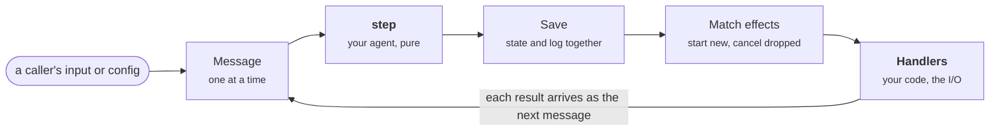

# How an agent works

_An agent describes how it behaves; a runner runs it._

## An agent is a description

An agent is a plain object. It says what the agent remembers, how it responds
to each thing that happens, and which effects it wants running in the world.
It never says how it is run.

Here is a whole agent. It keeps reminders: send it `remind` with some text and
a delay, and when the time comes it logs the reminder.

`src/agent.ts`:

```ts title="src/agent.ts"
import type { Agent, NoConfig } from '@acentric/types';

type Reminder = { key: string; text: string; at: number };
type Snapshot = { reminders: Reminder[] };
type Kinds = { '@timer': { args: { at: number }; result: null } };

const agent: Agent<Snapshot, NoConfig, Kinds> = {
  name: 'reminders',
  version: '0.1.0',

  init: () => ({ snapshot: { reminders: [] } }),

  step: ({ snapshot }, message, now) => {
    if (message.type === 'input' && message.kind === 'remind') {
      const text = String(message.payload['text']);
      const at = now + Number(message.payload['inSeconds']) * 1000;
      const reminder = { key: `remind:${at}`, text, at };
      return { snapshot: { reminders: [...snapshot.reminders, reminder] } };
    }
    if (message.type === 'effect') {
      const reminder = snapshot.reminders.find((r) => r.key === message.key);
      return {
        snapshot: {
          reminders: snapshot.reminders.filter((r) => r.key !== message.key),
        },
        append:
          reminder === undefined ? [] : [{ kind: 'reminder', body: reminder.text }],
      };
    }
    return { snapshot };
  },

  effects: ({ snapshot }) =>
    snapshot.reminders.map((r) => ({ key: r.key, kind: '@timer', args: { at: r.at } })),

  view: ({ snapshot }) => ({ pending: snapshot.reminders.length }),
};

export default agent;
```

| Part                              | What it does                                         |
| --------------------------------- | ---------------------------------------------------- |
| `init(config, now)`               | The first state of a new session                     |
| `step(state, message, now)`       | The next state, given one message                    |
| `effects(state)`                  | The effects the agent wants running now              |
| `view(state)`                     | What callers see of a session                        |
| `window(snapshot)`                | How much of the log step needs to see                |
| `migrate(snapshot, config, from)` | Moves a session's state to a new version of the code |

Only `init` and `step` are required.

`step` is the heart of it, and it is pure. Given the same state, message and
time, it always returns the same result, and it does nothing else: no network,
no files, no clock, no randomness. Everything else in these docs builds on that
rule.

A running agent is a **session**. Each session has its own state and history.
A chat agent might have one session per conversation; a reminders agent, one
per person.

## A runner runs it

The agent decides; the runner does everything else. It keeps each session's
state, delivers messages to `step` one at a time, saves what `step` returns,
and runs the effects the agent declares through **handlers**, the functions
that do the agent's I/O.

How it does that is the runner's choice: where state is kept, how many
processes run, what survives a crash, how many sessions fit. Acentric comes
with two runners, and a hosted one is coming:

| Runner         | Keeps sessions                            | For                                      |
| -------------- | ----------------------------------------- | ---------------------------------------- |
| Memory         | In memory                                 | Tests and scripts                        |
| Local          | In SQLite or plain files, across restarts | Development and single-machine apps      |
| Acentric Cloud | For you                                   | Hosting without running servers (coming) |

The same agent runs unchanged on every runner. Every runner follows one
contract and passes the same conformance tests; that is what makes this true.

**Anyone can write a runner.** The contract is public and the conformance
tests are a package: a runner for your own infrastructure, written in any
language, is as much an Acentric runner as ours. Acentric Cloud is one easy way
to host agents, with its own tools for watching and investigating sessions,
not the reason the framework exists. See [Runners](runners.md#writing-your-own).

React draws the same line. A component describes the UI, and a renderer
decides how it appears: in a browser, in a native app, on a server. An agent
is the component; a runner is the renderer.

## The loop

Everything that happens to a session happens one message at a time.



Your code (in bold) decides and does the I/O; the runner does everything in
between.

1. A message arrives: a caller's input, an effect's result, a config change, or
   the news that the session was upgraded.
2. `step` returns the next state and any new log entries.
3. The runner saves them together.
4. The runner compares the effects the agent now declares with the ones
   running. It starts new ones and cancels any no longer declared.
5. When an effect finishes, its result arrives as the next message.

Nothing outside the session sees a step until it is saved.

Take a reminder. The `remind` input adds it to the snapshot, so `effects` now
declares a `@timer`, and the runner starts it. When the timer fires, its
result arrives as a message; `step` logs the reminder and drops it from the
snapshot; `effects` no longer declares the timer, and there is nothing left to
run.

## Where the ideas come from

None of this is new. It combines ideas that have worked well elsewhere:

- **The Elm Architecture.** A model, messages, an update function, and
  commands as data. Elm's commands are our effects.
- **Functional core, imperative shell.** Pure decisions in the middle, I/O at
  the edges. The agent is the core; the runner and its handlers are the shell.
- **Effects as data.** The agent does not perform I/O. It describes it, and
  something else carries it out.

What is new is applying them to agents, which run for a long time, wait on
models and people, and are expected to survive.

## Next

- [State](state.md): The snapshot, the log, the window and config.
- [Messages](messages.md): The four things that can happen to a session.
- [Effects and handlers](effects.md): Declaring effects, and where I/O happens.
- [Runners](runners.md): What every runner promises, and writing your own.
